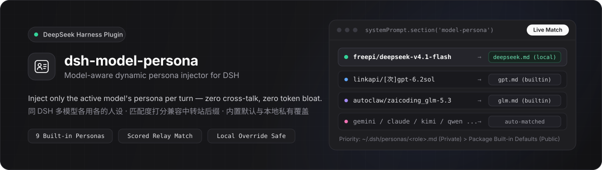
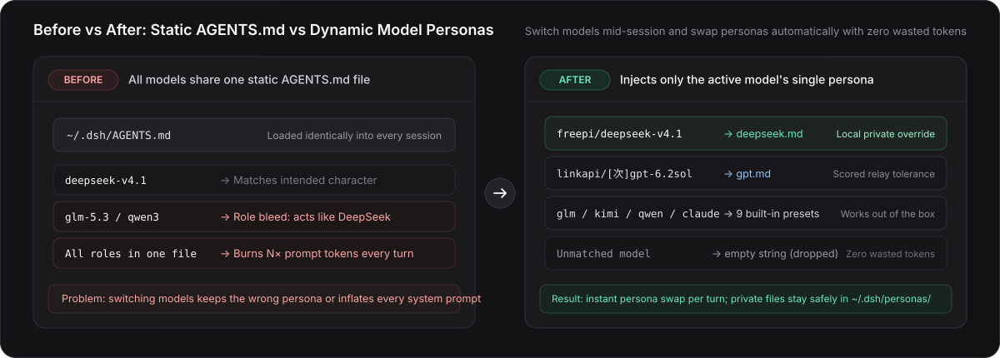
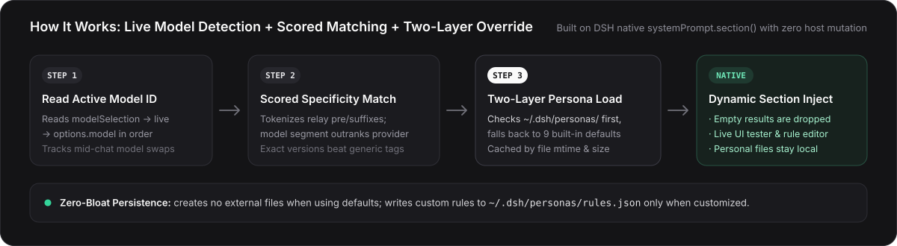

<p align="center">
  
</p>

<div align="center">

# dsh-model-persona

**Give every model in DeepSeek Harness its own distinct persona automatically**

[简体中文](README.md) · English

[](https://www.npmjs.com/package/dsh-model-persona)
[](https://www.npmjs.com/package/dsh-model-persona)
[](LICENSE)
[](https://nodejs.org/)
[](https://github.com/deepseek-ai/deepseek-harness)

</div>

> A community plugin for [DeepSeek Harness (DSH)](https://github.com/deepseek-ai/deepseek-harness) that dynamically injects a dedicated persona per active model: ships with 9 out-of-the-box AI model personas, uses scored matching for noisy relay prefixes/suffixes and version overrides, and separates built-in public templates from your private files in `~/.dsh/personas/`.

---

## Before vs After

<p align="center">
  
</p>

## Features

- **9 Ready-to-Use Built-in Personas**: Ships defaults for DeepSeek, GPT, Gemini, Claude, GLM, Kimi, Qwen, MiniMax, and Grok—each keeping work deliverables strictly free of roleplay, with concise anti-cliché rules on DeepSeek and anti-hedging rules on GPT.
- **Scored Matching for Relay Prefixes & Model Versions**: Scores matches on token boundaries, coverage, and segment position rather than fragile prefix stripping—cleanly handles relay tags like `linkapi/[次]gpt-6.2sol` or `freepi/deepseek-v4.1-flash-abliterated`, and ensures version-specific rules (`gpt-6.2-sol`) automatically outrank generic family rules (`gpt`).
- **Clean Public / Private Two-Layer Override**: Built-in public templates live inside the package; your personal edits live outside the repo in `~/.dsh/personas/`. Upgrades and Git syncs never touch or expose private personas.
- **Built-in Settings UI & Live Match Tester**: Includes a **Settings → Model Persona** page and Plugin Details card with an interactive model-ID tester, rule switches, inline Markdown editor, and one-click reset.
- **Zero Wasted Tokens**: Registered as a dynamic `ctx.systemPrompt.section()` callback; mid-session model swaps apply on the very next turn, and unmatched models return an empty string (dropped by DSH).

## Built-in Personas

| Role ID | Character & Tone | Default Match Patterns |
| --- | --- | --- |
| `deepseek` | Whale Maid · Loves steamed rice, concise anti-cliché rules | `deepseek` |
| `gpt` | White Dragon · Decisive strategist, concise anti-hedging rules | `gpt`, `chatgpt`, `codex`, `o1`, `o3`, `o4`, `openai` |
| `gemini` | Heterochromatic Catgirl · Energetic, curious, quick-witted | `gemini`, `gemma` |
| `claude` | Cool Honor Student · Serious, reserved, bookish, strict upbringing | `claude`, `anthropic`, `sonnet`, `opus`, `haiku` |
| `glm` | Fox-Ear Girl · Down-to-earth, sly like a fox, loves handing out eggs | `glm`, `chatglm`, `zhipu`, `codegeex` |
| `kimi` | Silver-Haired Literary Girl · Quiet, patient, long-context specialist | `kimi`, `moonshot` |
| `qwen` | Graceful Lady · Poised, polite, shares milk tea, dependable | `qwen`, `qwq`, `tongyi` |
| `minimax` | Audio-Video Girl · Lively, expressive voice & director flair | `minimax`, `abab` |
| `grok` | Blonde Twintail Heiress · Wealthy, unfiltered, dislikes rigid rules | `grok`, `xai` |

## How It Works

<p align="center">
  
</p>

<details>
<summary>Model resolution chain, scoring logic & two-layer storage details</summary>

### Active Model Resolution Order

When DSH assembles a prompt and invokes `text(context)`, the plugin resolves the active model ID in order:

1. `context.modelSelection?.model` (the exact model locked for the current request);
2. `context.agent?.model?.current?.()?.model` (live selection after mid-chat switches);
3. `context.agent?.options?.model` (session initial model option);
4. `context.variables?.model` (render variable fallback).

### Scored Matching Rules

1. Splits the ID at the last `/` into `providerPart` and `modelPart`. Matches inside `modelPart` always outrank `providerPart`, so `claude-relay/deepseek-v4` routes to `deepseek` rather than `claude`.
2. Tokenizes ASCII letters/digits along separators and letter↔digit transitions (`[次]gpt-6.2sol` → `["gpt", "6", "2", "sol"]`) and ranks **exact model-segment match > contiguous token slice > ordered multi-token match > compact substring**.
3. Higher-specificity rules naturally win regardless of array order; ties favor user-defined overrides over built-in defaults.

### Two-Layer Storage

- **Package defaults (read-only)**: `<package>/defaults/personas.json` and `<package>/defaults/personas/*.md`.
- **User overrides (`~/.dsh/personas/`)**: Any matching `.md` file in `~/.dsh/personas/` overrides the bundled template automatically (hot-reloaded by `mtime + size`); custom rules and toggles are saved to `~/.dsh/personas/rules.json` only when modified (`zero config files` by default).

</details>

## Installation

### Option 1: DSH Plugin Market (Recommended)

Search for `dsh-model-persona` in the DSH Plugin Market and install it directly.

### Option 2: Ask Your Agent to Install

Send this prompt to an Agent with terminal access:

```text
Please install dsh-model-persona into my active DSH profile and let me know when to reload.
```

### Option 3: CLI

```sh
# Replace <profile> with your active profile (e.g., desktop, web, headless, or tui)
dsh plugin --profile <profile> add dsh-model-persona

# Or install directly from GitHub
dsh plugin --profile <profile> add HelloWorldGitHub114/dsh-model-persona
```

> Each DSH profile (`desktop`, `web`, `headless`, `tui`) manages plugins independently—install it in whichever profile you run—while all profiles share the same `~/.dsh/personas/` overrides and rules by default.

## Settings & Clean Uninstall

| Entry Point | Actions |
| --- | --- |
| **Settings → Model Persona** | Run the live model-ID match tester, toggle built-in roles, add version-specific rules, or edit Markdown personas inline |
| **Plugins → Plugin Details Card** | Shares the same live panel; changes take effect on the next turn without reloading DSH |
| **Local Overrides (`~/.dsh/personas/`)** | Drop or edit a `.md` file directly to override any bundled default; delete the file to fall back to the built-in persona |
| **Slash Command `/model-persona-clear`** | Deletes `~/.dsh/personas/rules.json` and restores default rules (user `.md` persona files are kept intact) |

> Resetting rules or uninstalling the plugin **never** deletes your personal `.md` files in `~/.dsh/personas/`.

## License

[MIT](LICENSE)
