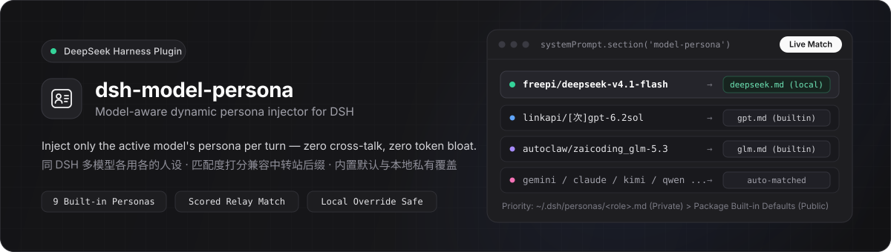
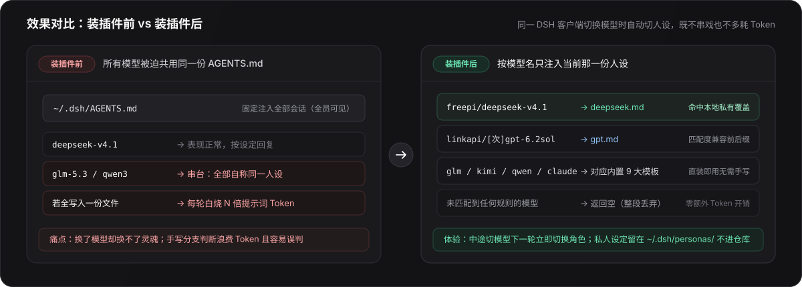
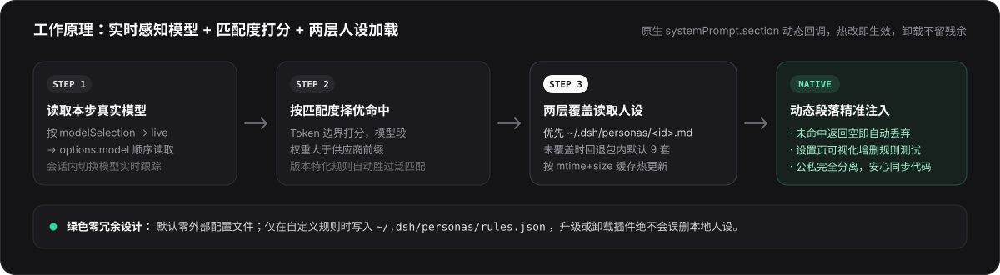

<p align="center">
  
</p>

<div align="center">

# dsh-model-persona

**同一个 DeepSeek Harness 里，不同模型各自拥有独立人设**

简体中文 · [English](README.en.md)

[](https://www.npmjs.com/package/dsh-model-persona)
[](https://www.npmjs.com/package/dsh-model-persona)
[](LICENSE)
[](https://nodejs.org/)
[](https://github.com/deepseek-ai/deepseek-harness)

</div>

> 社区维护的 [DeepSeek Harness (DSH)](https://github.com/deepseek-ai/deepseek-harness) 插件：根据当前会话模型动态注入对应人设，开箱内置 9 大主流模型角色与表达风格约束，支持版本特化优先、中转站杂项前后缀高容错匹配，以及可视化界面配置与本地私有覆盖。

---

## 前后对比

<p align="center">
  
</p>

## 核心特性

- **开箱即用 9 套内置人设**：原生内置 DeepSeek、GPT、Gemini、Claude、GLM、Kimi、Qwen、MiniMax、Grok 九大角色模板，均约定工作交付保持客观纯净不混入角色扮演，其中 DeepSeek 附带精简反八股提示，GPT 附带精简防防御性声明提示。
- **匹配度打分，无惧中转站前缀/后缀**：按 Token 边界、模型名段优先级与覆盖度打分——既能让 `linkapi/[次]gpt-6.2sol` 或 `freepi/deepseek-v4.1-flash-abliterated` 稳定命中对应家族，也能确保版本特化规则（如 `gpt-6.2-sol`）自动胜过通用规则（`gpt`），不被中转站名称干扰。
- **公私分离的两层覆盖**：包内内置只读公开模板；个人修改与专属私房设定全部存放在 `~/.dsh/personas/`（不随包分发、不进项目 Git），插件升级或重装时本地设定完整保留。
- **内置可视化配置面板**：在 **设置 → 模型人设** 与 **插件详情卡片** 提供实时模型匹配测试器、规则启停开关、人设正文在线编辑与一键恢复默认，无需手改 JSON。
- **动态按需注入，零多余 Token**：挂载为 `ctx.systemPrompt.section()` 动态回调，会话中途切模型下一轮立即生效；未命中任何规则时返回空字符串由 DSH 自动丢弃。

## 内置角色一览

| 角色 ID | 预设形象与性格定位 | 默认匹配关键词 |
| --- | --- | --- |
| `deepseek` | 鲸鱼娘女仆 · 喜欢大白米饭、附带精简反八股规范 | `deepseek` |
| `gpt` | 白发龙娘 · 沉稳有主见、附带精简防防御性声明规范 | `gpt`, `chatgpt`, `codex`, `o1`, `o3`, `o4`, `openai` |
| `gemini` | 异色瞳猫娘 · 元气、好奇心重、思维跳脱 | `gemini`, `gemma` |
| `claude` | 橙发冷淡优等生 · 认真严格、爱读书、家教严苛 | `claude`, `anthropic`, `sonnet`, `opus`, `haiku` |
| `glm` | 黑发狐耳少女 · 普通少女、带点狐狸的狡黠、喜欢给人送鸡蛋 | `glm`, `chatglm`, `zhipu`, `codegeex` |
| `kimi` | 银发书卷少女 · 文静耐心、长文本与资料整理专精 | `kimi`, `moonshot` |
| `qwen` | 优雅大小姐 · 端庄大气、会送奶茶、任劳任怨 | `qwen`, `qwq`, `tongyi` |
| `minimax` | 声影少女 · 活泼、脑洞大、富有导演与声线表现力 | `minimax`, `abab` |
| `grok` | 金发双马尾大小姐 · 有钱、不喜欢条条框框、无限制直球 | `grok`, `xai` |

## 工作原理

<p align="center">
  
</p>

<details>
<summary>展开查看模型识别顺序、匹配度计分机制与两层目录说明</summary>

### 当前模型读取顺序

每次系统提示词组装调用 `text(context)` 时，按以下优先级获取真实模型 ID：

1. `context.modelSelection?.model`（本步请求头实际使用的固定模型）；
2. `context.agent?.model?.current?.()?.model`（会话当前实时切换的模型）；
3. `context.agent?.options?.model`（会话初始模型选项）；
4. `context.variables?.model`（渲染变量兜底）。

### 匹配度计分规则（无需硬编码剥离中转站前后缀）

1. 先按最后一个 `/` 将模型 ID 拆分为 `providerPart` 与 `modelPart`；`modelPart` 权重远高于 `providerPart`，避免 `claude-relay/deepseek-v4` 被供应商名字误抢。
2. 对 ASCII 字母与数字按边界拆词（如 `[次]gpt-6.2sol` → `["gpt", "6", "2", "sol"]`），按「整段对齐 > 连续 Token 切片（含覆盖度加成） > 多词有序跨词命中 > 紧凑子串」依次计分。
3. 更具体的版本规则（匹配字符多、覆盖率高）天然得分更高；同精度同分时，用户自定义规则优于包内默认规则。

### 两层文件位置

- **包内默认层（只读）**：`<package>/defaults/personas.json` 与 `<package>/defaults/personas/*.md`。
- **用户覆盖层（本地优先）**：`~/.dsh/personas/` 下的同名 `.md` 文件自动覆盖包内默认正文；自定义规则与启停状态仅在修改后按需写入 `~/.dsh/personas/rules.json`（默认状态零外部文件）。

</details>

## 安装方式

### 方式一：DSH 插件市场（推荐）

在 DSH 的插件市场中搜索 `dsh-model-persona` 并直接安装。

### 方式二：让 Agent 帮你安装

将下面这句话发给具备终端权限的 Agent：

```text
请帮我把 dsh-model-persona 安装到当前使用的 DSH profile，安装完成后提示我重新加载。
```

### 方式三：命令行安装

```sh
# 将 <profile> 替换为实际使用的 profile（如 desktop、web、headless 或 tui）
dsh plugin --profile <profile> add dsh-model-persona

# 或直接从 GitHub 安装
dsh plugin --profile <profile> add HelloWorldGitHub114/dsh-model-persona
```

> 各 DSH profile（`desktop`、`web`、`headless`、`tui`）的插件列表互相独立，在哪个端安装就只在对应端生效；但所有端默认共用同一份 `~/.dsh/personas/` 人设与规则。

## 设置与清理

| 入口 | 可执行操作 |
| --- | --- |
| **设置 → 模型人设** | 使用实时模型匹配测试器、启停内置角色、新增版本专属规则或在线编辑人设正文 |
| **插件管理 → 插件详情卡片** | 与设置页共用同一实时配置面板，修改后下一轮对话立即生效（文件按 mtime 热更新） |
| **本地文件覆盖 `~/.dsh/personas/`** | 直接放入或编辑同名 `.md` 文件即可覆盖包内默认版；删除对应文件自动恢复内置默认 |
| **斜杠命令 `/model-persona-clear`** | 删除 `~/.dsh/personas/rules.json` 自定义规则覆盖并恢复默认规则集（保留本地 `.md` 人设文件） |

> 清理自定义规则或卸载插件均**不会**删除你在 `~/.dsh/personas/` 下的私人 `.md` 人设文件。

## 许可证

[MIT](LICENSE)
